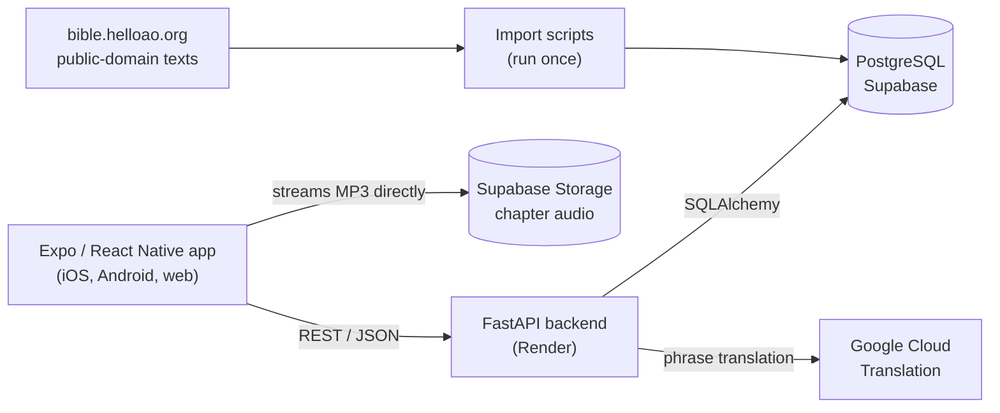

# BibleLingo

**Learn Spanish or French by reading the New Testament**: bite-sized lessons generated from the text
itself, tap-to-translate on any phrase, and real recorded audio for every Spanish chapter.

**▶ [Try the live demo](https://YOUR-DEMO-LINK)** · works in any browser, no sign-up (best on a phone)

<!-- TODO: record a 10–15 second GIF (path screen → a lesson → the reader with audio playing)
     and save it as docs/demo.gif. ScreenToGif (Windows) or the Expo web build in Chrome works well. -->


> The server is on a free plan. If nobody has used it for a while, the first screen shows
> "Waking up the server…" for up to a minute.

---

## What it does

- **A path through the Bible.** Each book is a unit and each chapter a level with three steps:
  **Key Words**, **Verse Practice**, then **Read & Listen**.
- **Lessons built from the text, not written by hand.** Because every verse exists in English,
  Spanish and French (matched by verse number), exercises can be generated automatically:
  pick the right translation, fill in the blank, put the words in order, true/false, match pairs.
- **Key Words that are actually useful.** Vocabulary is chosen from each chapter, then filtered to
  words that are also common in everyday Spanish/French, so learners study *casa* rather than rare
  biblical terms.
- **Read & Listen.** The full chapter in the language being learned. Tap one word, then another,
  to select a phrase and translate it. Spanish chapters play a real recording, with a progress
  bar and a "back 10 seconds" button; other languages fall back to the device's text-to-speech.
- **Habit features.** Streaks, hearts that refill over time, and progress saved on the device.

## How it's built



| Part | Tech |
|---|---|
| App | Expo SDK 57, React Native, `expo-audio`, `expo-speech`, AsyncStorage |
| API | Python, FastAPI, SQLAlchemy, Pydantic |
| Data | PostgreSQL and Storage on Supabase |
| Services | Google Cloud Translation |
| Hosting | Render (API), <!-- TODO: Vercel / Netlify --> (web app) |

**Data pipeline** (all in `backend/app/`, each safe to re-run):

1. `import_gospels.py` downloads all 27 New Testament books in three public-domain translations
   (World English Bible, Reina-Valera 1909, Louis Segond 1910), caches them, and loads the verses.
2. `build_vocab.py` picks each chapter's key words and glosses them once with Google Translate.
3. `generate_lessons.py` turns verses and vocabulary into lessons and exercises.
4. `import_audio.py` links every chapter to its recording in Supabase Storage.

## Decisions and tradeoffs

- **Public-domain translations only**, so the whole text can be stored, shown and reused freely.
- **Generated, not hand-written, lessons.** Generation covers all 260 New Testament chapters in two
  languages from data the app already has. Pure functions keep the generator testable without a database.
- **Audio streams straight from Supabase Storage.** The API only hands out the link, so large files
  never pass through the small free-tier server.
- **Progress lives on the device for now.** No sign-up wall for someone trying the app. Storage is
  isolated in `src/storage.js`, so moving it to the backend after Google sign-in is a single file.
- **Guardrails for a public link.** Translations are cached, limited per visitor, and capped per
  day, so the demo can't run up a Google Cloud bill. The app retries while the free server wakes
  up instead of failing, and a scheduled GitHub Action keeps it awake.

## What I'd do next

- **Grade answers on the server.** Today the app grades exercises and lesson responses include the
  answers; the `POST /exercises/{id}/submit` endpoint exists for moving this server-side.
- **Wire up Google sign-in** (built on the backend) to sync progress, hearts and streaks per user.
- **Highlight each verse while the recording plays** by storing verse start/end times
  (the `verses` table already has `audio_start` / `audio_end` columns).
- **Speech recognition** for the speak exercise, **spaced repetition** for vocabulary, and
  **Alembic migrations** instead of `create_all`.

## Run it locally

You need Python 3.11+, Node 20+, a free Supabase project, and (for Translate) a Google Cloud key.

```bash
# Backend
cd backend
python -m venv venv
venv\Scripts\activate            # macOS/Linux: source venv/bin/activate
pip install -r requirements.txt
copy env.example .env            # then fill it in (macOS/Linux: cp)
python -m app.import_gospels     # load the verses (first run downloads ~800 chapters)
python -m uvicorn app.main:app --reload --host 0.0.0.0

# App (second terminal)
cd bible-lang-app
npm install
npx expo start                   # press w for web, or scan the QR code with Expo Go
```

`backend/README.md` has the full setup, every import option, and troubleshooting.

## Deploy

**API (Render):** root directory `backend`, build `pip install -r requirements.txt`,
start `uvicorn app.main:app --host 0.0.0.0 --port $PORT`. Set the variables from `env.example`,
including `ALLOWED_ORIGINS` = your web app's address.

**Web app (Vercel, Netlify or any static host):** in `bible-lang-app`, create `.env` from
`.env.example` (your API address, `EXPO_PUBLIC_DEMO_MODE=true`), then
`npx expo export --platform web` and publish the `dist/` folder.

**Keep it awake:** add a repository variable `API_URL` (Settings → Secrets and variables →
Actions → Variables). `.github/workflows/keep-awake.yml` then pings it every 10 minutes.

## Credits

- Scripture text: World English Bible, Reina-Valera 1909, Louis Segond 1910 (public domain), via
  [bible.helloao.org](https://bible.helloao.org).
- Spanish audio: Reina-Valera 1909 recordings from <!-- TODO: name the source and its license -->.

Built by <!-- TODO: your name --> · [GitHub](https://github.com/sjean149) · <!-- TODO: LinkedIn / portfolio -->
